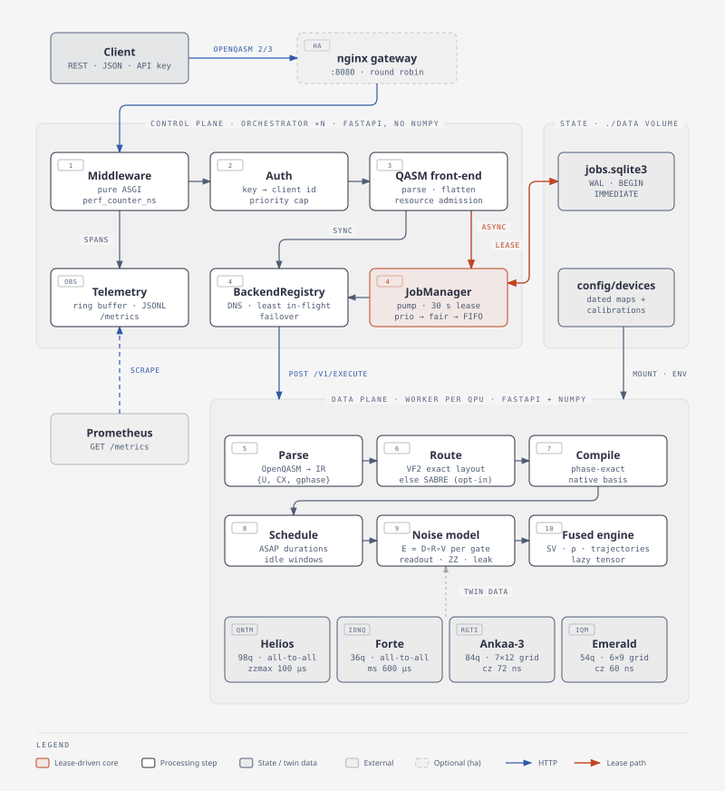

# QPUTwin: Calibration-Faithful Digital Twins of Trapped-Ion and Superconducting Quantum Processors


**QPUTwin** is an open-source **quantum digital twin** and **QPU emulator**. It reproduces four real quantum processors behind one OpenQASM API, modelling each one's native gate set, qubit connectivity, calibrated noise and gate timing. Every processor runs as its own containerised twin; a FastAPI orchestrator routes OpenQASM 2.0/3.x circuits to them and returns results with exact, additive latency telemetry.

| Digital twin | Processor | Technology | Qubits | Connectivity |
|---|---|---|---|---|
| `quantinuum_helios` | Quantinuum Helios | Trapped ion (QCCD) | 98 | All-to-all |
| `ionq_forte` | IonQ Forte | Trapped ion | 36 | All-to-all |
| `rigetti_ankaa_3` | Rigetti Ankaa-3 | Superconducting | 84 | 7 × 12 square lattice |
| `iqm_emerald` | IQM Emerald | Superconducting | 54 | 6 × 9 square lattice |

## Highlights

* **Calibration-faithful noise.** Each gate's error channel is solved to reproduce its published fidelity exactly, and every calibration value is tagged `published` or `assumed`.
* **Hardware constraints enforced.** Phase-exact native compilation; topology violations are rejected, or routed with an opt-in exact-layout-first SABRE router.
* **Three engines, built from scratch.** Statevector, density-matrix and quantum-trajectory engines in `numpy`, with no vendor or third-party quantum SDK.
* **A real service.** Durable asynchronous jobs with leases, fair sharing and priorities, worker auto-discovery, API keys, Prometheus metrics and an HA gateway.



## Quick start

Prerequisites: Docker with Compose v2, and [`uv`](https://docs.astral.sh/uv/).

```bash
docker compose up -d --build                                   # orchestrator + four twins
curl -s localhost:8000/v1/backends | python3 -m json.tool      # list the emulated QPUs

curl -s localhost:8000/v1/jobs -H 'content-type: application/json' -d '{
  "backend": "ionq_forte",
  "qasm": "OPENQASM 2.0;\ninclude \"qelib1.inc\";\nqreg q[2];\ncreg c[2];\nh q[0];\ncx q[0],q[1];\nmeasure q -> c;",
  "shots": 1000, "seed": 7
}' | python3 -m json.tool
```

Interactive API documentation is served at <http://localhost:8000/docs>. Run the tests with `uv run pytest`.

## Documentation

Everything else (installation, the full API, the physics, operations and the benchmark results) is in the documentation site under [`docs/`](docs/index.md). Browse it locally with:

```bash
uv run --group docs mkdocs serve      # http://127.0.0.1:8088
```

| Start here | |
|---|---|
| [Getting started](docs/getting-started/index.md) | installation, quick start, tutorial |
| [Concepts](docs/concepts/index.md) | digital twins, architecture, execution pipeline, devices |
| [User guide](docs/guide/index.md) | jobs, OpenQASM, compilation, noise, engines, routing, timing, calibration, telemetry |
| [Reference](docs/reference/index.md) | HTTP API, parameters, responses, errors, configuration |
| [Operations](docs/operations/index.md) | deployment, scaling, security, monitoring |
| [Research](docs/research/index.md) | benchmarks, simulator comparison, validation, reproducibility, limitations |

## License

Apache License 2.0; see [LICENSE](LICENSE) and [NOTICE](NOTICE).

Koustav Kumar Mondal · erkoustavkumar@gmail.com
