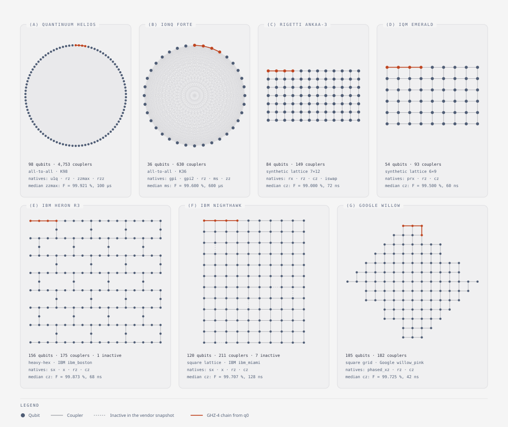

# Emulated devices

| Backend ID | Device | Technology | Qubits | Connectivity | Native 1Q | Native 2Q | CX realised with |
|---|---|---|---|---|---|---|---|
| `quantinuum_helios` | Quantinuum Helios | Trapped ion (¹³⁷Ba⁺, QCCD) | 98 | all-to-all $K_{98}$ | `u1q(θ,φ)`, virtual `rz` | `zzmax`, `rzz(θ)` | 1 × ZZMax |
| `ionq_forte` | IonQ Forte | Trapped ion (¹⁷¹Yb⁺) | 36 | all-to-all $K_{36}$ | `gpi(φ)`, `gpi2(φ)`, virtual `rz` | `ms(φ₀,φ₁,θ)`, `zz(θ)` | 1 × MS |
| `rigetti_ankaa_3` | Rigetti Ankaa-3 | Superconducting transmons | 84 | 7 × 12 square lattice | `rx(kπ/2)`, virtual `rz` | `cz`, `iswap` | 1 × CZ |
| `iqm_emerald` | IQM Emerald | Superconducting transmons | 54 | 6 × 9 square lattice | `prx(θ,φ)`, virtual `rz` | `cz` | 1 × CZ |

## Gate definitions

| Gate | Matrix / definition |
|---|---|
| `U(θ,φ,λ)` | OpenQASM 2 definition $\begin{pmatrix}\cos\frac\theta2 & -e^{i\lambda}\sin\frac\theta2\\ e^{i\phi}\sin\frac\theta2 & e^{i(\phi+\lambda)}\cos\frac\theta2\end{pmatrix}$ |
| `u1q(θ,φ)`, `prx(θ,φ)` | $R(\theta,\phi) = e^{-i\frac\theta2(\cos\phi X + \sin\phi Y)}$ |
| `gpi(φ)` | $\begin{pmatrix}0 & e^{-i\phi}\\ e^{i\phi} & 0\end{pmatrix}$ |
| `gpi2(φ)` | $R(\pi/2,\phi)$ |
| `ms(φ₀,φ₁,θ)` | $e^{-i\frac\theta2\,\sigma_{\phi_0}\otimes\sigma_{\phi_1}}$, θ in radians (IonQ's API uses turns) |
| `rzz(θ)`, `zz(θ)` | $e^{-i\frac\theta2 Z\otimes Z}$; `zzmax` = `rzz(π/2)` |
| `cz`, `iswap` | standard |

Every closed form is checked against `scipy.linalg.expm` of its generator in the test suite.

## Connectivity

{ .qt-diagram }

* **Trapped ion.** Any pair of distinct qubits may interact; the complete graph is stored implicitly.
* **Superconducting.** A symmetric boolean adjacency matrix `A` is held as a numpy array. Every pair of qubits touched by every multi-qubit operation, *after* library expansion, must satisfy `A[p, q] = 1`. A `ccx` therefore cannot run on a square lattice, because the lattice has no triangles.

On a grid, qubit `(r, c)` has index `r·cols + c`. Inspect any coupling map with:

```bash
curl -s localhost:8000/v1/backends/rigetti_ankaa_3 | python3 -c \
  'import json,sys; d=json.load(sys.stdin); print(d["coupling_map"]["n_edges"], d["coupling_map"]["degree"])'
```

!!! warning "Methods note: synthetic coupling maps"
    The packaged superconducting maps are **synthetic** nearest-neighbour lattices that match each device's published qubit count and connectivity class. They are not vendor calibration snapshots, which would contain defective qubits and couplers. Load a real map at runtime, with no code change; see [Calibration data](../guide/calibration.md).

## Calibration at a glance

| Device | Published values used | Assumed placeholders |
|---|---|---|
| Quantinuum Helios | 1Q 99.9975 %, 2Q 99.921 % (Quantinuum launch blog); SPAM 99.967 % (Sandia/Quantinuum benchmark) | all durations; QCCD transport and gate-zone parallelism not modelled; T1/T2 not modelled (hyperfine coherence far exceeds circuit times) |
| IonQ Forte | 1Q 99.98 %, 2Q 99.6 %, SPAM 99.5 % (IonQ Forte system page) | gate times (IonQ *Aria* figures 135 µs / 600 µs), readout/reset times, T1 = 10 s and T2 = 1 s (Aria), one entangling gate at a time |
| Rigetti Ankaa-3 | median iSWAP 99.0 % at 72 ns (Ankaa-3 launch) | CZ = iSWAP fidelity; 1Q fidelity and duration; readout; T1 = 30 µs, T2 = 20 µs |
| IQM Emerald | median CZ 99.5 %, 1Q 99.93 % (IQM / Amazon Braket launch); T1 = 54.7 µs, T2 = 16.6 µs (arXiv:2608.30176) | durations; readout fidelity (IQM Radiance typical value) |

`GET /v1/backends/{id}` returns the complete calibration, including a `provenance` tag for every field.
