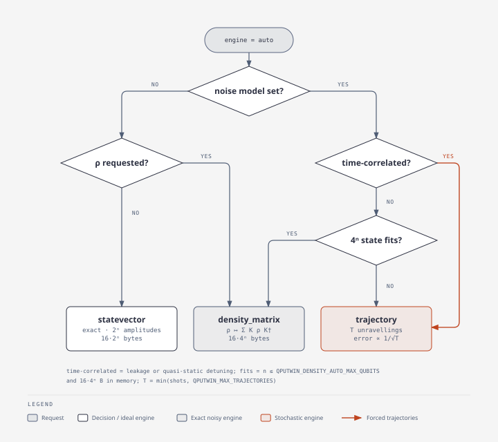

# Simulation engines

| Engine | State | Exact? | Width in a 12 GiB worker | Used for |
|---|---|---|---|---|
| `statevector` | $2^n$ amplitudes | exact (ideal) | 27 qubits (28 at complex64) | ideal runs |
| `density_matrix` | $4^n$ entries | exact (noisy) | 14 qubits | noisy runs up to `QPUTWIN_DENSITY_AUTO_MAX_QUBITS` (10) |
| `trajectory` | $2^n$ per trajectory | exact when trajectories = shots | 27 qubits | wide noisy runs, leakage, quasi-static detuning |

## Automatic selection (`engine: "auto"`)

{ .qt-diagram }

Override it with `options.engine`. Asking for a combination that cannot work, such as noise on `statevector` or leakage on `density_matrix`, returns a `400` error that explains why.

## Fused execution

Both exact engines run a branch-free program (every measurement terminal; the common case) through **gate fusion**:

1. **Plan.** The native gate list is fused into dense blocks of at most 5 qubits (statevector) or 2 qubits = 4 row/column axes (density matrix). The planner keeps several open blocks on disjoint qubits (they commute), grows a block while it fits, and carries small blocks into the next one rather than flushing them. Blocks made only of diagonal gates stay diagonal, are stored as their diagonal, and may span up to 12 qubits (statevector) or 12 axes (density matrix). Consecutive diagonal blocks are merged, because diagonals always commute. Matrix entries below 10⁻¹⁵ (rounding noise such as cos π/2) are set to zero; otherwise they decay, block after block, into denormal numbers that the CPU processes about 100× more slowly.
2. **Lazy activation.** The state starts as a single amplitude. A qubit that no block has touched yet is exactly `|0⟩` and is not stored. A block that reaches new qubits uses only the matrix columns where they are 0, so the stored state grows as the circuit spreads: a GHZ chain reaches full size only in its last block, and diagonal blocks never enlarge the state.
3. **Execute.** The state is a tensor whose axis order changes lazily. A block whose qubits are adjacent in that order is one batched `U @ X` with no data movement. Otherwise the block's qubits are gathered next to the lowest contiguous qubits, chunk by cache-sized chunk, and multiplied in the same pass. Diagonal blocks multiply by a phase table, also per cache chunk. The passes are split across `QPUTWIN_ENGINE_THREADS` threads (default: the worker's CPU quota).
4. **Read out without reordering.** Terminal measurements are sampled from the marginal in the stored order, and only the drawn outcomes are relabelled. The full state is never transposed back to standard order, and the probabilities are written into the state's own memory. Large distributions are sampled with a two-level inverse CDF: block totals first, then only the blocks a draw lands in.
5. **Trailing phases.** Diagonal gates after which no non-diagonal gate touches their qubits are dropped when no statevector is requested; they cannot change any measurement probability.

In the density-matrix engine every gate ($U\otimes U^*$), noise channel, depolarisation and reset is a superoperator on the (row, column) axes of its qubits, so **a gate and the noise after it become one matrix product**. The fused results equal the per-gate reference kernels to < 1e-12 (tested for every device, block width and thread count). Against the original per-gate engine, the speed-up is 24–105× on one thread and 74–138× on a worker's four threads (20–24-qubit statevectors, 10–12-qubit noisy density matrices); see the [simulator comparison](../research/simulator-comparison.md).

## Statevector

A dense vector in little-endian order: bit *q* of the index is simulated qubit *q*.

* Branch-free circuits use fused execution (above).
* The per-gate reference kernels update the state **in place** on reshaped views (peak ≈ 2× the state). They serve the shot-branching and trajectory paths.
* Diagonal gates (`rz`, `cz`, `rzz`, `zzmax`) are element-wise phase multiplications.
* Sparse two-qubit matrices skip their zero blocks.
* Terminal measurements are sampled once by exact inverse-CDF sampling, using O(shots) memory.
* Mid-circuit measurement, reset and feed-forward use **shot branching**: one simulation per reachable classical branch.

## Density matrix

ρ is stored as a $4^n$ vector, with row qubit q at bit n+q and column qubit q at bit q. Branch-free programs run as fused superoperator blocks (above); circuits with mid-circuit measurement use the per-gate kernels:

* unitary $U\rho U^\dagger$: $U$ on the row qubits, $U^*$ on the column qubits;
* one-qubit channel: one 4×4 superoperator $S = \sum_k K_k\otimes K_k^*$ on the (row, column) pair;
* depolarising: sliced partial trace;
* reset: a channel, not a branch;
* measurement probabilities: the real diagonal.

It reports `purity` = Tr ρ². With `return_density_matrix: true` (≤ 8 qubits, terminal circuits) you get ρ itself.

## Quantum trajectories

Each trajectory evolves a statevector and unravels each channel stochastically:

* Kraus operators are sampled with Born weights $p_k = \mathrm{Tr}(K_k\rho_qK_k^\dagger)$, computed from the qubit's reduced density matrix;
* depolarising becomes random Pauli jumps;
* quasi-static detuning is drawn once per trajectory;
* leakage is tracked per trajectory.

Measurements and resets keep exact binomial shot branching.

* With **trajectories = shots** (the default, up to `QPUTWIN_MAX_TRAJECTORIES` = 2000), sampling is exact, and `result.noise.exact_sampling` is `true`.
* With fewer, the run samples the empirical mixture of $T$ trajectories; the error falls roughly as $T^{-1/2}$ until it reaches the shot-noise floor (see [benchmark](../research/benchmarks.md#trajectory-convergence)).

## Precision

`options.precision` (or `QPUTWIN_PRECISION`) selects `complex128` (the default) or `complex64`. Single precision halves memory and runs ~1.9× faster at 24 qubits in the [scaling benchmark](../research/benchmarks.md#engine-scaling), and agrees with complex128 to within 1e-5 per amplitude, which is the tolerance the test suite checks.

## Memory and width limits

Two limits apply:

1. `QPUTWIN_MAX_SIM_QUBITS` caps the simulated width per worker. It defaults to the device size.
2. The **memory-feasibility guard** estimates the peak working set as 2 × state + 16 B per basis state + one state per pending branch, and compares it with the memory actually available to the container (cgroup v2 limit minus usage, or `MemAvailable`, minus a 256 MiB reserve).

A job that does not fit returns `422 ResourceLimitError` with `required_bytes`, `available_bytes` and `max_feasible_qubits`, so the worker is never OOM-killed. Only qubits a circuit **touches** count toward the width (active-qubit compaction).
