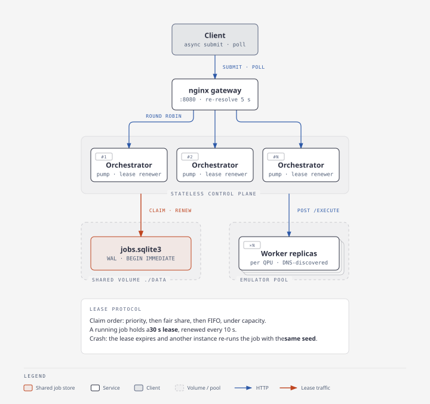

# Scaling & high availability

{ .qt-diagram }

## Worker replicas

```bash
# in .env
QPUTWIN_FORTE_REPLICAS=3
# or ad hoc
docker compose up -d --scale worker-ionq-forte=3
```

With `QPUTWIN_DISCOVERY=dns` (set by Compose), the orchestrator resolves each worker service name to **all** of its containers every 10 s:

* Jobs go to the replica with the fewest in-flight requests, round-robin among ties.
* A replica that refuses the connection is skipped and the job fails over to the next one. A timeout is never retried, because the worker may already be executing the job.
* The asynchronous dispatch capacity grows with the replica count.
* `GET /v1/backends` lists each replica's status, in-flight and dispatched counts, and failures; telemetry records which replica served each job.

## Orchestrator replicas

```bash
QPUTWIN_ORCHESTRATOR_REPLICAS=3 QPUTWIN_ORCHESTRATOR_PORTS=8000-8002 \
  docker compose --profile ha up -d --wait          # gateway on :8080
```

* All replicas share `./data/jobs.sqlite3`. Claims are atomic and enforce the global per-backend capacity, so N orchestrators never overload a worker.
* The nginx gateway re-resolves `orchestrator` through Docker DNS every 5 s, and moves on to another replica when a connection fails.
* Each orchestrator keeps its own `/v1/telemetry` ring buffer. The JSONL dataset is shared and complete.

## Failure behaviour

| Event | What happens |
|---|---|
| Worker replica stops | its connections are refused; jobs fail over to other replicas |
| Orchestrator stops gracefully | its running async jobs are released to the queue immediately |
| Orchestrator crashes | after the lease (30 s), another instance re-runs the job with the same seed; `attempt` = 2 |
| Same job lost `QPUTWIN_JOB_MAX_ATTEMPTS` times | `FAILED` with an "abandoned" error |
| Store unavailable | `/ready` returns 503; the gateway and load balancers stop routing to that instance |

Both drills were run against the live stack with two orchestrators behind the gateway:

* **Graceful stop:** six queued and running jobs all completed on the survivor.
* **`SIGKILL` mid-job:** the job was re-run by the other instance (attempt 2) with identical counts.

## Throughput expectations

From the [scaling benchmark](../research/benchmarks.md#horizontal-scaling), on one 12-thread laptop CPU:

| Workload | 1 replica | 2 replicas | 3 replicas |
|---|---|---|---|
| 14 qubits (256 KiB state) | 114 jobs/s | 145 jobs/s | 164 jobs/s |
| 20 qubits (16 MiB state) | 15.5 jobs/s | 26.2 jobs/s | 35.2 jobs/s |

* **Small jobs** (≈ 4 ms of worker time) are limited by the orchestrator's asynchronous dispatch to one backend, at roughly 160 jobs/s, so extra workers help little (1.43× with three). Add orchestrator replicas instead.
* **Large statevectors** scale well on one host: 2.27× with three replicas, with per-job time growing 29%. The fused engine reads and writes the state once per gate block rather than several times per gate, so replicas share memory bandwidth far better than before fusion (1.44×). Beyond the host's cores, scale across **hosts**.

From the [load tests](../research/load-testing.md), synchronous light jobs (GHZ₈, 256 shots):

| Setup | Peak throughput |
|---|---|
| one worker | 270 jobs/s |
| four QPUs, one orchestrator | 366 jobs/s |
| four QPUs, three orchestrators behind the gateway | 622 jobs/s |
| heavy QV-style 12-qubit jobs, 1 → 4 Forte replicas | 11.6 → 25.2 jobs/s |

* Add **orchestrator replicas** (`QPUTWIN_ORCHESTRATOR_REPLICAS`, profile `ha`) once fast jobs exceed about 300 jobs/s; the gateway also keeps an overloaded orchestrator stable.
* Keep the concurrency per worker near the knee of its throughput curve (8–16 clients for millisecond jobs), or use the asynchronous queue, which never sends a worker more than its capacity.

## Limits

The SQLite store coordinates instances on **one host**. Spreading orchestrators across hosts requires a networked store implementing the `JobStore` interface (`qputwin_orchestrator/jobs.py`).
