# Benchmark results

All figures are produced by `benchmarks/run_benchmarks.py` (data) and `benchmarks/plot_figures.py` (figures). Vector PDF and SVG versions, 300-dpi PNGs, the raw JSON results and a CSV of every plotted value are in `benchmarks/`.

!!! info "Setup"
    | Item | Value |
    |---|---|
    | CPU | 12th Gen Intel Core i5-12450H (12 logical CPUs) |
    | Software | QPUTwin 0.1.0, Python 3.13, numpy 2.5.4, Docker 29.9 |
    | Configuration | `OMP_NUM_THREADS=1`; each worker limited to 4 CPUs / 12 GiB |
    | Host load during the run | load average ≈ 2.3–2.9 |
    | Date | 2026-10-28 |
    | Methods | live experiments go through the full HTTP stack; in-process experiments call the same simulator classes directly |

    Absolute times depend on the host; ratios and trends are the transferable results. **Calibration values tagged `assumed`** (mainly gate durations and superconducting readout fidelity) affect the noise and timing results; see [Emulated devices](../concepts/devices.md#calibration-at-a-glance).

!!! tip "More benchmarks"
    * [Circuit-family benchmarks](circuit-benchmarks.md): nine circuit families on all four QPUs, a QV-style heavy-output test and routing overhead by algorithm.
    * [Load & stress testing](load-testing.md): up to 256 concurrent clients, queueing-theory checks, a five-minute soak, a 2 000-job async burst, fair share and scale-out.

## Latency decomposition

<figure markdown>
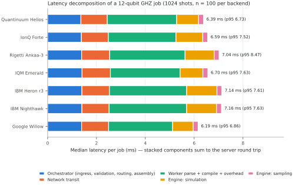
<figcaption>Median server round trip of a 12-qubit GHZ job (1024 shots, 100 jobs per backend, live stack), decomposed into additive telemetry spans.</figcaption>
</figure>

| Backend | Median | p95 | Orchestrator | Network | Worker parse + compile | Engine |
|---|---|---|---|---|---|---|
| Quantinuum Helios | 6.56 ms | 7.66 ms | 1.46 | 1.27 | 2.77 | 1.08 |
| IonQ Forte | 6.61 ms | 7.99 ms | 1.46 | 1.22 | 2.70 | 1.23 |
| Rigetti Ankaa-3 | 6.82 ms | 7.53 ms | 1.39 | 1.22 | 2.89 | 1.36 |
| IQM Emerald | 6.81 ms | 8.78 ms | 1.49 | 1.34 | 2.78 | 1.10 |

**Finding.** For small circuits the engine is only 16–20% of the round trip. Parsing, compilation and overhead in the worker (41–42%) and the orchestration path (38–42%: validation, routing, network) dominate. The emulation layer is therefore the bottleneck for small jobs, which matters when interpreting quantum-cloud latency studies.

<figure markdown>
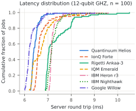{ width="520" }
<figcaption>Empirical CDF of the round trip. The distributions are tight (p95 ≈ 1.10–1.29 × median); the slowest of 400 jobs took 11.2 ms.</figcaption>
</figure>

## Engine scaling

<figure markdown>
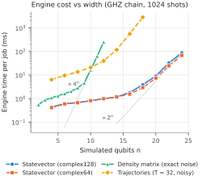{ width="520" }
<figcaption>Engine time per job versus simulated width (GHZ chain, 1024 shots, median of 3 runs, in-process, one engine thread). Dotted guides: 2ⁿ and 4ⁿ.</figcaption>
</figure>

| Engine | Largest width tested | Time (1 thread) | Before fusion |
|---|---|---|---|
| Statevector, complex128 | 24 qubits | 87 ms | 11.0 s |
| Statevector, complex64 | 24 qubits | 68 ms | 5.9 s |
| Density matrix (exact noise) | 12 qubits | 0.25 s | 10.7 s |
| Trajectories (T = 32, noisy) | 18 qubits | 2.8 s | 2.8 s |

**Finding.** The statevector grows roughly as $2^n$ above ~18 qubits (below that, fixed per-job overhead dominates). The density matrix grows as $4^n$. [Fused execution](../guide/engines.md#fused-execution) made both exact engines far faster: 126× (statevector) and 43× (density matrix) on this GHZ chain. The GHZ chain is the best case, because lazy activation keeps the state small until the last block. A deep random circuit is still dense work: a 24-qubit QV-style circuit takes 7.6 s on one thread (2.5× faster than Qiskit Aer, 2.9× slower than qsim; see the [simulator comparison](simulator-comparison.md)). The trajectory engine still applies gates one at a time, so it is unchanged. `engine: auto` uses the density matrix up to 10 qubits and trajectories above. See the [simulator comparison](simulator-comparison.md) for how these speeds rank against Qiskit Aer, qsim, Qulacs, Braket and Cirq.

## Cost of routing

<figure markdown>
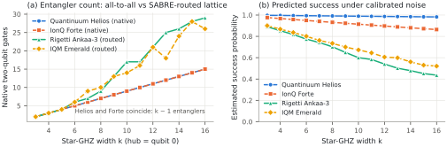
<figcaption>(a) Native entanglers for a star-GHZ state: k − 1 on the all-to-all twins (the Helios and Forte curves coincide), SABRE-routed on the lattices. (b) Estimated success probability under calibrated noise.</figcaption>
</figure>

| k | Helios / Forte entanglers | Ankaa-3 (SWAPs) | Emerald (SWAPs) | ESP Helios / Forte / Ankaa-3 / Emerald |
|---|---|---|---|---|
| 8 | 7 | 9 (2) | 10 (1) | 0.991 / 0.932 / 0.702 / 0.735 |
| 12 | 11 | 21 (4) | 21 (4) | 0.987 / 0.897 / 0.540 / 0.606 |
| 16 | 15 | 29 (6) | 26 (5) | 0.982 / 0.864 / 0.436 / 0.521 |

<figure markdown>
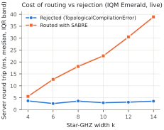{ width="520" }
<figcaption>Live round trip on IQM Emerald: rejected without routing versus routed with SABRE (median, IQR band, 15 jobs per point).</figcaption>
</figure>

**Finding.** Rejection is cheap and nearly constant (2.6–3.7 ms). A star with more leaves than any physical qubit has neighbours cannot be embedded, so SABRE routes it. With 16 layout trials scored by the emitted circuit, routing costs 0.6–31 ms of router time and up to 39 ms of round trip at k = 14, and it inflates the entangler count 1.7–1.9× at k = 16. The fidelity price is the larger one: the predicted success at k = 16 falls to 0.44–0.52, against 0.86–0.98 on the all-to-all twins. The commutation-aware cancellation pass removed 2–8 entanglers in almost every instance with k ≥ 6.

!!! note "Fewer SWAPs for more router time"
    The previous router used 4 trials and kept the trial with the fewest SWAPs in a trial pass over the two-qubit gates alone, not the cheapest emitted circuit after cancellation. It needed 36–42 entanglers at k = 16 (ESP 0.40–0.47) in 1.0–7.2 ms of router time. Scoring 16 trials by their emitted two-qubit count removes 10–16 entanglers at k = 16 and costs about 4× the router time, which is still small next to the round trip. Set `routing.trials` to trade one for the other.

## GHZ fidelity

<figure markdown>
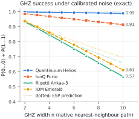{ width="520" }
<figcaption>GHZ success P(0…0) + P(1…1) under each device's calibrated noise (density matrix, exact; 100 000 shots). Dotted: the estimated success probability (ESP).</figcaption>
</figure>

| n | Helios | Forte | Ankaa-3 | Emerald |
|---|---|---|---|---|
| 2 | 0.999 | 0.987 | 0.934 | 0.938 |
| 6 | 0.994 | 0.950 | 0.754 | 0.780 |
| 10 | 0.990 | 0.914 | 0.569 | 0.612 |

**Finding.** The ESP (a product of gate and readout fidelities) is accurate for the trapped-ion twins but **overestimates** the superconducting ones (0.661 vs 0.569 for Ankaa-3 and 0.696 vs 0.612 for Emerald at n = 10). The ESP ignores idle decoherence and the T1 decay of the $|1\dots1\rangle$ branch during the aligned read-out, both of which the exact simulation includes.

## Error budget

<figure markdown>
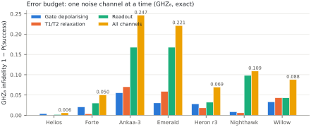
<figcaption>GHZ₆ infidelity with one noise channel at a time (density matrix, 200 000 shots).</figcaption>
</figure>

**Finding.**

* **Superconducting twins:** readout dominates (0.168), ahead of T1/T2 relaxation (0.058–0.070) and gate depolarisation (0.030–0.055).
* **Forte:** SPAM (0.030) and gates (0.021) matter.
* **Helios:** total error is only 0.006, and T1/T2 are not modelled for its hyperfine qubits.

The superconducting readout fidelity is an *assumed* typical value (97%), so replacing it with a measured snapshot changes the leading term.

## Hardware time

<figure markdown>
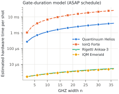{ width="520" }
<figcaption>Estimated hardware time per shot from the ASAP gate-duration model (GHZ along a native path). Log scale.</figcaption>
</figure>

| n | Helios | Forte | Ankaa-3 | Emerald |
|---|---|---|---|---|
| 2 | 0.27 ms | 1.04 ms | 1.65 µs | 1.64 µs |
| 12 | 1.37 ms | 8.39 ms | 2.77 µs | 2.64 µs |
| 36 | 4.01 ms | 26.0 ms | 5.46 µs | 5.04 µs |

**Finding.** Superconducting shots take microseconds, trapped-ion shots milliseconds: a gap of **three orders of magnitude**. Forte is slower than Helios because of its (assumed, Aria-derived) gate times and serial entangling gates. Most durations are `assumed`, so treat these as order-of-magnitude estimates until a snapshot is loaded. Per-shot overhead is excluded.

## Noise sensitivity

<figure markdown>
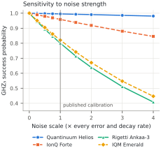{ width="520" }
<figcaption>GHZ₅ success versus a global noise scale (× every error and decay rate; 1 = published calibration).</figcaption>
</figure>

**Finding.** At scale 1, GHZ₅ success is 0.995 (Helios), 0.959 (Forte), 0.800 (Ankaa-3) and 0.821 (Emerald). At scale 4 it falls to 0.981, 0.845, 0.408 and 0.447. The superconducting twins sit in a far steeper part of the curve, so a 2× improvement in their error rates moves success much more than the same improvement on the ions.

## Trajectory convergence

<figure markdown>
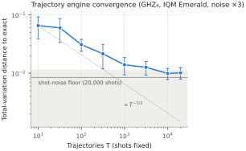{ width="520" }
<figcaption>Total-variation distance between trajectory results and the exact density-matrix distribution (GHZ₄ on Emerald at noise × 3, 20 000 shots, 5 seeds). Grey band: shot-noise floor (mean and 95th percentile).</figcaption>
</figure>

**Finding.** The error falls from 0.072 (T = 10) to 0.012 (T = 1000), roughly as $T^{-1/2}$, and reaches the 20 000-shot noise floor (0.0085) by T ≈ 3000. With trajectories = shots (the default), sampling is exact.

## Horizontal scaling

<figure markdown>
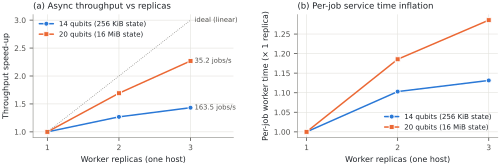
<figcaption>(a) Asynchronous throughput speed-up versus worker replicas on one host (IonQ Forte, star GHZ, 64 shots). (b) Median per-job worker time relative to one replica.</figcaption>
</figure>

| Workload | 1 replica | 2 replicas | 3 replicas | Worker time per job |
|---|---|---|---|---|
| 14 qubits (256 KiB) | 114 jobs/s | 145 (1.27×) | 164 (1.43×) | 4.1 → 4.5 → 4.6 ms |
| 20 qubits (16 MiB) | 15.5 jobs/s | 26.2 (1.69×) | 35.2 (2.27×) | 59 → 70 → 76 ms |

**Finding.** Two different limits appear:

* **Small jobs** finish in about 4 ms of worker time, so one worker already delivers 114 jobs/s. Throughput then levels off near 164 jobs/s with three replicas (1.43×), close to the single orchestrator's asynchronous dispatch rate. More orchestrators lift that ceiling (see [load testing](load-testing.md#orchestrator-scale-out)).
* **20-qubit jobs** scale 2.27× with three replicas, while per-job worker time grows 29% (59 → 76 ms) as the replicas share memory bandwidth. Before gate fusion each gate made several full passes over the 16 MiB state, per-job time doubled with three replicas and throughput reached only 1.44×. The current engine reads and writes the state once per block and keeps it small until the circuit has spread, so one worker runs these 20-qubit jobs 9.5× faster than before fusion (15.5 against 1.64 jobs/s).

## Non-Markovian dephasing

<figure markdown>
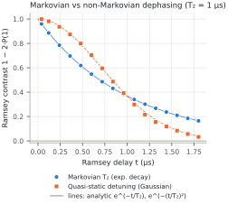{ width="520" }
<figcaption>Ramsey contrast on IQM Emerald: Markovian T₂ (density matrix, 200 000 shots) versus quasi-static detuning with σ = 225 kHz (trajectories, 4000 shots, exact sampling), chosen to give the same 1/e time T₂ = 1 µs. Lines: analytic e^(−t/T₂) and e^(−(t/T₂)²).</figcaption>
</figure>

**Finding.** Both models match their analytic curves. The quasi-static model preserves coherence longer at short delays and loses it faster afterwards (Gaussian decay). A per-window Markovian channel cannot reproduce this, which is why the term is trajectory-only.

## Reproduce

```bash
docker compose up -d --wait
uv run --group bench python benchmarks/run_benchmarks.py all     # ~70 min incl. load tests; restarts workers for scaling runs
uv run --group bench python benchmarks/plot_figures.py
```
