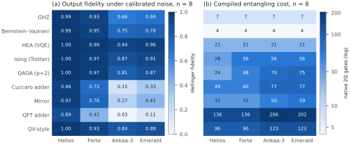
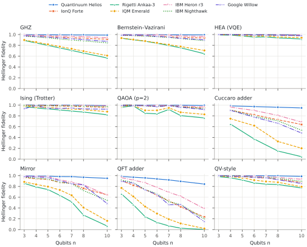
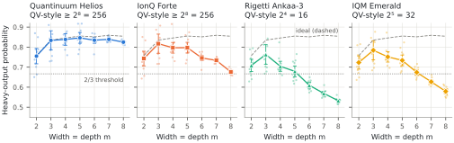
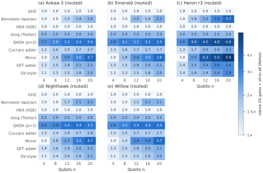
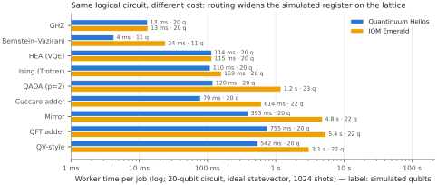

# Circuit-family benchmarks

A single GHZ chain says little about a QPU. This page runs **nine circuit families** with different structure on all four emulated devices. Each family stresses a different part of the stack: connectivity, depth, Toffoli count, or how spread out the output distribution is.

!!! info "Method"
    | Item | Value |
    |---|---|
    | Circuits | `benchmarks/circuits.py`, seed 1, every qubit measured `q[i] → c[i]` |
    | Noise | the packaged calibration of each device; every channel on |
    | Engine | exact density matrix, 50 000 shots per point (noisy widths 3–10) |
    | Reference | the exact ideal distribution from the statevector, cross-checked against 200 000 sampled shots |
    | Metric | Hellinger fidelity $F_H(p,q) = \left(\sum_x \sqrt{p_x q_x}\right)^2$; for deterministic circuits it equals the probability of the correct answer |
    | Routing | exact SWAP-free layout when one exists, otherwise SABRE (seed 0, 16 / 8 / 4 / 2 layout trials by size, the trial with the fewest emitted two-qubit gates kept) on Ankaa-3 and Emerald; native all-to-all on Helios and Forte |
    | Cost table | ideal statevector, 1024 shots, widths 4–20 |
    | Data | `benchmarks/results/circuits.json`, `qv.json`; CSVs in `benchmarks/figures/data/` |

    Reproduce with `uv run --group bench python benchmarks/run_benchmarks.py circuits qv`, which takes about 30 minutes.

## The nine families

| Family | Structure | Ideal output | What it stresses |
|---|---|---|---|
| **GHZ** | H + linear CX chain | two outcomes | shallow, nearest-neighbour |
| **Bernstein–Vazirani** | oracle CXs to one ancilla | one outcome (the secret) | star connectivity |
| **HEA (VQE)** | 3 layers of `ry·rz` + CX ladder | spread | 1Q-heavy, linear 2Q |
| **Ising (Trotter)** | 4 steps of `rzz` chain + `rx` | spread | nearest-neighbour `rzz` |
| **QAOA (p=2)** | `rzz` on a seeded 3-regular graph + `rx` | spread | non-planar interaction graph |
| **Cuccaro adder** | MAJ/UMA ripple-carry, Toffoli-heavy | one outcome (the sum) | decomposed `ccx` depth |
| **Mirror** | random layers then their exact inverse | `0…0` | depth with no ideal-simulation cost |
| **QFT adder** | QFT, phase addition, QFT† (Draper) | one outcome (the sum) | all-to-all `cu1` ladders |
| **QV-style** | *m* layers of random 3-CX two-qubit blocks | spread (Porter–Thomas-like) | depth = width, random pairing |

QAOA uses a ring when *n* is odd, because a 3-regular graph needs an even number of vertices. That is why its curves are not monotonic in *n*.

## Fidelity and cost at eight qubits

**Reading.**
- **(a)** The rows are ordered from easy to hard. Helios keeps fidelity at 0.89 or above on every family. Forte ranges from 0.99 (HEA) down to 0.42 (QFT adder). On the superconducting lattices fidelity collapses for the deep, entangler-heavy families: the QFT adder reaches 0.026 on Ankaa-3 and 0.11 on Emerald.
- **(b)** On the lattices, GHZ, BV and HEA embed without a single SWAP (the exact layout finds a chain or star), so their entangler count matches Helios. Routing raises it by up to 3.1× for QAOA: 24 native two-qubit gates on Helios, 70 on Ankaa-3, 75 on Emerald. Forte doubles the count for `rzz`-based circuits (Ising, QAOA), because each `rzz` takes two MS gates.

## Fidelity versus width

Every family shows the same device ranking: Helios > Forte > Emerald > Ankaa-3. The *rate* of decay depends on the family. The deep deterministic circuits (adder, mirror, QFT adder) fall fastest: at *n* = 10 on Ankaa-3 they reach 0.044, 0.066 and 0.004.

!!! warning "Hellinger fidelity flatters high-entropy outputs"
    For families whose ideal output is spread over many bitstrings (QV-style, HEA, Ising, QAOA), noise pushes the output *towards* uniform. The ideal output is already close to uniform, so the Hellinger fidelity stays high even when the circuit is badly corrupted. For example, the QV-style circuit at *n* = 8 on Ankaa-3 has $F_H = 0.84$ but an estimated success probability of only 0.15. Use the **deterministic families** (GHZ, BV, adder, mirror, QFT adder) or the **heavy-output test** below to compare devices.

## Quantum-volume-style heavy-output test

The test runs 12 random circuits per width *m* (depth = *m*). For each, it computes the ideal heavy set: outcomes above the median ideal probability. The noisy heavy-output probability (HOP) is then estimated under calibrated noise. A width **passes** if the mean HOP minus two standard errors exceeds 2/3. The figure reports the largest width *m* for which every width up to *m* passes.

| Device | Widths passing | QV-style result |
|---|---|---|
| Quantinuum Helios | 2–8 (all tested) | ≥ 2⁸ = 256 |
| IonQ Forte | 2–8 (all tested; m = 8 by a margin of 0.002) | ≥ 2⁸ = 256 |
| IQM Emerald | 2–5 | 2⁵ = 32 |
| Rigetti Ankaa-3 | 2–4 | 2⁴ = 16 |

!!! note "Not a certified quantum volume"
    The two-qubit blocks are generic random 3-CX circuits, not Haar-random SU(4). There are 12 circuits per width rather than ≥ 100, and the ideal HOP of these circuits is about 0.85. Treat the numbers as a *relative* comparison of the emulated noise models, not as a vendor QV claim.

## Routing overhead by family

Each cell is the native two-qubit count on the lattice divided by the count on all-to-all Helios, for the same logical circuit:

* **mirror** circuits suffer most, at 3.6–3.7× at *n* = 20. Their random pairings put every interaction far apart, which leads to 175–177 SWAPs;
* **QAOA** follows at 3.4–3.5×, because a 3-regular graph is not planar;
* the **QFT adder**, **QV-style** and **Bernstein–Vazirani** circuits need about 2.0–2.2×, and the Cuccaro **adder** 1.7×;
* **GHZ** and **HEA** cost nothing extra (1.0×): their interaction graph is a path, and the exact layout places it on the lattice without SWAPs. **Ising** shows 2.0× on every device without any SWAP, because each `rzz` needs two native entanglers outside Helios;
* **IonQ Forte** has an overhead of 1.00× everywhere except `rzz` circuits (Ising, QAOA). There it is 2.0×, because Forte's MS entangler needs two MS gates per `rzz` while Helios has a native ZZ gate.

## Where the worker's time goes

This chart shows the worker time per job at *n* = 20 on all-to-all Helios and on the Emerald lattice. Each label gives the number of qubits the emulator actually simulated. The logical circuit is identical. Families that embed without SWAPs (GHZ, HEA, Ising) cost about the same on both devices (1.0–1.4×; Ising's `rzz` needs two CZs on Emerald). The routed families take 5.1–11× longer on the lattice, because both routing and simulation grow:

* simulation takes 0.23–3.1 s on Emerald, against 0.08–0.67 s for the whole job on Helios;
* SABRE with 8–16 layout trials takes 0.3–1.8 s, most for the deep families (mirror, QFT adder, QV-style). With the faster engine, routing is now comparable to simulation, and for the Cuccaro adder it is the larger stage (297 against 225 ms). Pass `routing.trials` = 1–4 to trade a few extra SWAPs for a faster route.

!!! tip "Routing can enlarge the simulated register"
    SABRE moves logical qubits through physical qubits the circuit never named. The emulator simulates every physical qubit the routed circuit touches, so a 20-qubit circuit can need a wider statevector on a sparse lattice. Each extra qubit doubles memory and time. Measured at *n* = 20:

    | Family | Helios / Forte | Ankaa-3 | Emerald | Emerald worker time vs Helios |
    |---|---|---|---|---|
    | QFT adder | 20 | **24** | 22 | 4.6 s vs 0.67 s (6.9×) |
    | QAOA | 20 | 22 | **23** | 1.0 s vs 0.12 s (8.8×) |
    | Cuccaro adder | 20 | **23** | 22 | 0.55 s vs 0.08 s (7.0×) |
    | QV-style | 20 | 22 | 22 | 2.6 s vs 0.51 s (5.1×) |
    | GHZ | 20 | 20 | 20 | 12 ms vs 12 ms (1.0×) |

    The rest of the gap comes from the extra SWAP gates themselves and from routing time. Before the exact-layout and trial-scoring fixes, a 20-qubit QFT adder simulated 25 qubits on Emerald (and GHZ 23), at 60× the engine time of Helios.

    Pass a smaller `QPUTWIN_MAX_SIM_QUBITS`, or compare `compilation.simulated_qubits` with `declared_qubits`, to catch this before a long run.

## Takeaways

1. **No single circuit ranks devices fairly.** Fidelity loss depends on the family as much as on the device.
2. **Connectivity is a fidelity cost.** The lattice devices pay for routing twice: extra entanglers *and* a longer schedule over which relaxation acts.
3. **Use deterministic or heavy-output metrics** when comparing noise models; plain distribution fidelity is optimistic for random circuits.
4. **Watch the simulated width** on lattices: it, not the declared width, sets the emulator's cost.
