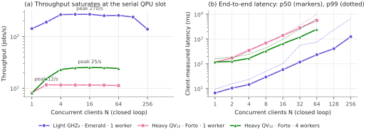
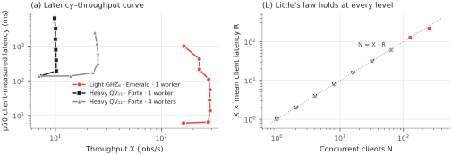
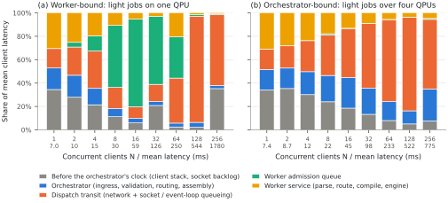
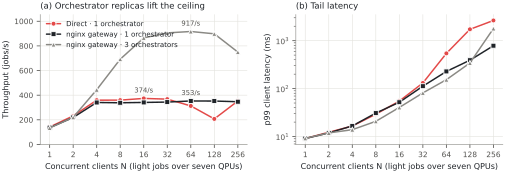
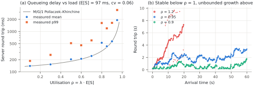
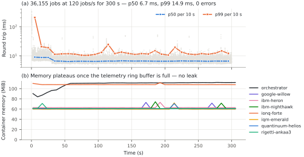
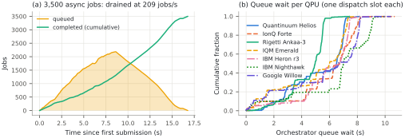
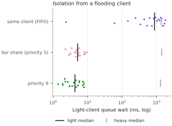
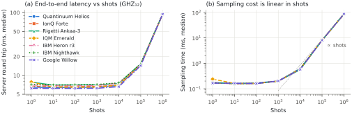
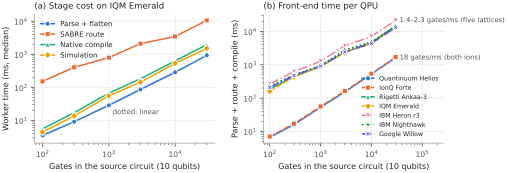

# Load & stress testing

This page drives the live Docker stack hard and measures how throughput, latency and isolation behave. Every request goes through the full HTTP path: client → (gateway) → orchestrator → worker → engine.

!!! info "Setup"
    | Item | Value |
    |---|---|
    | Host | Intel Core i5-12450H (4 performance + 4 efficiency cores, 12 threads), 16 GB RAM, one machine runs the clients and the stack |
    | Stack | 1 orchestrator, 1 worker per QPU (4 CPUs / 12 GiB each), `QPUTWIN_WORKER_CONCURRENCY=1` (one job at a time, like a QPU) |
    | Light job | GHZ₈, 256 shots: the engine needs under 1 ms, so the job measures the *system*, not the physics |
    | Heavy job | QV-style, 12 qubits, 1024 shots, IonQ Forte: ≈ 85 ms of worker time per job |
    | Load generator | `httpx` + `asyncio`; 3 client processes for the scale-out runs, each under 0.8 core |
    | Latency | measured **at the client** unless stated otherwise (see [Where the queue lives](#where-the-queue-lives)) |
    | Data | `benchmarks/results/{load_closed,load_ha,load_open,soak,async_burst,fairshare,shots,gate_scaling}.json` |

    Reproduce with `uv run --group bench python benchmarks/run_benchmarks.py load_closed load_ha load_open soak async_burst fairshare shots gate_scaling`, which takes about 45 minutes and restarts the stack with different replica counts.

## Summary

| Test | Result |
|---|---|
| Peak sync throughput, one worker, light jobs | **270 jobs/s** at 16 clients (client p50 58 ms) |
| Peak sync throughput, four QPUs, 1 orchestrator | **366 jobs/s**; the orchestrator is the bottleneck |
| … with 3 orchestrators behind nginx | **622 jobs/s** (1.70×) |
| Heavy jobs, 1 → 4 worker replicas | 11.6 → **25.2 jobs/s** (2.2×) |
| Five-minute soak, 120 jobs/s | **36 155 jobs, 0 errors**, client p50 9.7 ms / p99 21 ms, memory flat after warm-up |
| Async burst | **2 000 jobs accepted in 6.5 s** (309/s), all completed, drained at 161 jobs/s |
| Fair share vs a flooding client | light client's median wait **875 ms → 5 ms** |
| Little's law, N = X·R | median deviation 0.3 %, worst 4.3 % (over 50 load levels) |
| Errors across all load tests | **0** (no 5xx, no timeouts, no lost jobs) |

## Closed loop: throughput and latency vs concurrency

Each of *N* clients sends its next job as soon as the previous one returns.

* **One worker saturates at its serial slot.** Light jobs reach 270 jobs/s at *N* = 16, so a worker spends about 3.7 ms per job: HTTP, JSON, parse and compile. The emulated QPU time is only 0.8 ms. Heavy jobs saturate at 11.6 jobs/s from *N* = 2. Their worker time (~84 ms) is mostly parsing (29 ms) and native compilation (26 ms) of a 1 400-gate circuit; the engine needs only 27 ms of it.
* **Past saturation, latency grows linearly in *N*** while throughput stays flat, which is the closed-loop signature of a single queue. For heavy jobs: 117 ms at *N* = 1, 5.6 s at *N* = 64.
* **Light-job throughput sags by about half at 256 clients** (270 → 139 jobs/s). Every waiting request still costs the single-process Python worker some event-loop and GIL time, so heavy oversubscription has a real overhead. Keep the concurrency per worker near its knee (about 8), or use the [asynchronous queue](../guide/async-jobs.md), which never sends a worker more than its capacity.
* **Four worker replicas give 2.2× heavy throughput** (11.6 → 25.2 jobs/s) rather than 4×. With four CPU-bound jobs running at once on this laptop CPU, each job slows down (the engine time alone grows from 27 to 33 ms at 16 clients). That fits shared turbo budget, hyper-threads and efficiency cores, though we did not isolate the cause. Linear scale-out needs dedicated cores per replica.

The latency–throughput curves show the classic "hockey stick": throughput stops rising while latency keeps climbing. Panel (b) checks **Little's law** $N = X \cdot R$, using the measured throughput $X$ and mean client latency $R$. It holds with a median deviation of 0.3 %. The worst case is 4.3 %, for heavy jobs at 64 clients, where a 5.4 s mean latency is a sixth of the 30 s window. That confirms no requests were lost or double-counted.

## Where the queue lives

The telemetry's additive breakdown shows *where* a job waits as load rises:

* **(a) Worker-bound:** light jobs on one QPU. Up to about 32 clients the wait is mostly in the worker's **admission queue** (`worker_queue_ms`, green; 75 % of the latency at 16 clients, 58 % at 32), exactly where it should be. Beyond that, requests wait *before* the worker's handler starts: in its socket backlog and in the orchestrator's event loop. The telemetry reports this as **dispatch transit** (orange).
* **(b) Orchestrator-bound:** light jobs over four QPUs. The four workers have spare capacity, and the queue builds in the orchestrator's dispatch path from about 8 clients.

!!! warning "Server-side telemetry cannot see every queue"
    The orchestrator's clock starts when its middleware receives a request. Time a request spends in the kernel's accept queue, or waiting for a busy event loop, appears either as `network_transit_ms` or not at all in `total_roundtrip_ms`. Under overload, measure latency **at the client** as well. In an earlier single-process mixed run at 128 clients, the server-side p50 read 15 ms while the client-side p50 was 455 ms. The [limitations](limitations.md) page lists this.

## Orchestrator scale-out

The orchestrator is a single Python process, so with fast jobs spread over many QPUs it becomes the ceiling. Replicas behind the nginx gateway lift it:

| Setup | Peak throughput | p99 at 32 clients | p99 at 256 clients |
|---|---|---|---|
| Direct, 1 orchestrator | 366 jobs/s | 205 ms | 0.91 s |
| nginx gateway, 1 orchestrator | 342 jobs/s | 130 ms | **0.86 s** |
| nginx gateway, 3 orchestrators | **622 jobs/s** | 104 ms | 3.1 s |

* Three orchestrators give **1.70× the direct peak**, not 3×. All 12 hardware threads are shared by 3 orchestrators, 4 workers, nginx and 3 client processes, so this host runs out of cores first.
* nginx costs about 7 % of peak throughput but **keeps a single overloaded orchestrator stable**: throughput holds at 317–329 jobs/s from 32 to 256 clients, while direct connections dip to 246 jobs/s with a 1.7 s p99 at 128 clients (against 484 ms through nginx). nginx absorbs connection churn the Python event loop handles poorly.

## Open loop: queueing theory check

Jobs arrive as a Poisson process at rate λ, independent of completions. A single worker with a nearly constant service time (E[S] = 85 ms, coefficient of variation 0.07) should then behave like an **M/G/1 queue**. The Pollaczek–Khinchine formula predicts the mean response time:

$$
\bar R = R_0 + \frac{\lambda\,\mathbb{E}[S^2]}{2\,(1-\rho)}, \qquad \rho = \lambda\,\mathbb{E}[S],
$$

where $R_0$ is the unloaded round trip.

* **(a)** The measured mean follows the prediction within 4 % at ρ = 0.1, 0.3, 0.6 and 0.7 (for example ρ = 0.7: 225 ms measured, 217 ms predicted), within 7–9 % at ρ = 0.85 and 0.9, and within 12 % at ρ = 0.5. Near saturation individual 30–60 s windows scatter far from the curve (ρ = 0.8: 427 vs 288 ms; ρ = 0.95: 1.46 vs 0.93 s). That is expected, because the relaxation time of an M/G/1 queue grows as $(1-\rho)^{-2}$ and exceeds the window.
* **(b)** Below ρ = 1 the response time fluctuates around a stable level. At ρ = 1.2 it grows without bound, by about 0.32 s per second of overload. Plan capacity for **ρ ≲ 0.7** if you need a bounded p99.

## Soak: five minutes of sustained load

The soak test sends 120 jobs/s as Poisson arrivals over all four QPUs (36 155 jobs) and records `docker stats` every 5 s:

* **No errors**, and no drift: p50 stays between 6.9 and 8.1 ms in every 10-s window. Only the first window has a higher p99 (147 ms, against at most 27 ms afterwards), from cold connections and caches.
* **Memory plateaus.** The freshly started orchestrator grows from 85 to 112 MiB during the first ~65 s, while its 10 000-record telemetry ring buffer fills (`QPUTWIN_TELEMETRY_BUFFER`). It then stays at 111–112 MiB for the remaining four minutes, apart from two single samples at 121 MiB that fall straight back. The workers stay flat within a few MiB (66–123 MiB; one transient Emerald peak of 89 MiB), so there is no leak in the request path, the ring buffer or the JSONL writer.

## Asynchronous burst

2 000 async jobs (500 per QPU) are submitted by 16 concurrent clients:

* **Admission is fast:** 309 jobs/s accepted (p50 14 ms per `202` at 16 concurrent submitters, 3.4 ms one at a time), and the queue peaked at about 1 590 jobs.
* **Draining runs at 161 jobs/s** over four one-slot QPUs. Completions speed up visibly once submissions stop, because the same orchestrator both accepts and dispatches.
* All 2 000 jobs completed, and the four QPUs finished their 500 jobs within 0.1 s of each other (12.3–12.4 s): with the faster engine, the shared orchestrator, not any one worker, sets the drain rate.

## Fair-share isolation

A "heavy" client floods IonQ Forte with 300 jobs as one burst. A "light" client then submits 20 jobs, 100 ms apart. Each job takes about 10 ms end to end on the worker.

| Light client | Median wait | Max wait |
|---|---|---|
| Same client name as the flood (plain FIFO) | 875 ms | 1.79 s |
| Own name, priority 5 (**fair share**) | **5.1 ms** | 9.5 ms |
| Own name, priority 9 | 4.3 ms | 7.9 ms |

Fair share alternates the single dispatch slot between active clients (least-recently-served first), so the light client waits for at most the job in progress, not for the whole backlog. Under FIFO it waits behind everything the flood queued first.

!!! success "Found and fixed by this benchmark"
    The first run of this experiment showed **no isolation**: fair share ranked clients only by their *running* jobs. With one slot per QPU that count is zero for everyone whenever the slot frees, so the order fell back to FIFO. The scheduler now breaks the tie by *least recently served*. That gives round-robin between clients, verified by `test_fair_share_round_robin_with_one_slot` for both job stores. The "last served" order is kept in a small `client_usage` table updated once per claim, so the ordering is a primary-key lookup. An intermediate version derived it from the job history with an extra index, which turned a cheap running-jobs count into a scan of each client's history and slowed the 2 000-job burst from 13 s to 208 s; that version never shipped.

!!! success "Found and fixed by this benchmark: retention scanned the whole job table"
    Every async submission ran the retention pass, whose two `DELETE`s scanned every stored job. Accept latency therefore grew with history: 16.7 ms per submission with ~6 000 stored jobs. Retention now uses partial indexes over finished jobs, trims only when over the limit, and runs at most every 2 s on the submission path. A single submission now takes 3.4 ms, independent of history (`test_submissions_do_not_prune_every_time`, `test_retention_keeps_the_newest_finished_jobs`).

## Shots and circuit size

* Up to 10⁴ shots the round trip is flat at about 6–7 ms; sampling costs 0.17 ms at one shot and 0.7 ms at 10⁴.
* Sampling then grows **linearly**, at about 68 ns per shot (68 ms for 10⁶ shots), and dominates the job. The response stays small because only the counts are returned.

* **Parsing is linear** at about 37 gates/ms. A 30 000-gate (300 kB) circuit takes 0.82–0.87 s to parse in the worker. The orchestrator's validation parses it **again** (0.86–0.88 s), which doubles the front-end cost for very large circuits.
* **SABRE routing** dominates on the lattices: 8.7 s for 30 000 gates on Emerald and 9.7 s on Ankaa-3, 3.1–3.5 gates/ms for the router alone. The automatic trial count steps down with size (16 / 8 / 4 / 2), so routing time grows sub-linearly between 3 000 and 10 000 gates (1.7 → 2.8 s) and linearly beyond.
* **Native compilation** runs at 45–47 gates/ms on the ions.

!!! success "Found and fixed by this benchmark"
    IonQ Forte's compile time first grew *quadratically*: 4.1 s at 30 000 gates against 0.66 s on Helios. The ASAP gate-duration scheduler rescanned every booked interval for each gate on devices with a parallelism limit. It now prunes intervals that end before the earliest qubit clock, and the schedule is bit-for-bit identical (`test_interval_pruning_keeps_the_schedule_identical`). Forte's compile time at 30 000 gates fell to **0.67 s** (6×).

## Recommendations

1. **Size workers by service time, not job count.** A worker's capacity is 1 / (worker time per job). Watch `qputwin_replica_in_flight` and keep the concurrency per worker near the knee of the throughput curve.
2. **Prefer the asynchronous queue under bursty load.** It bounds in-flight work per worker and gives fair share and priorities. The synchronous path has neither.
3. **Run 2–3 orchestrators behind the gateway** once fast jobs exceed about 300 jobs/s, and give replicas dedicated cores.
4. **Measure latency at the client** when you load-test; server telemetry is exact for what it sees but blind to accept-queue time.
5. **Route very large circuits once.** For 10⁴+ gates, SABRE time dominates. Submit pre-routed native circuits, or reduce SABRE trials, if routing cost matters.
