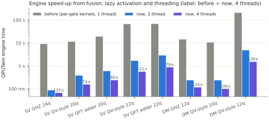
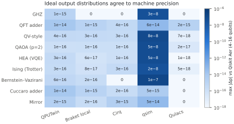
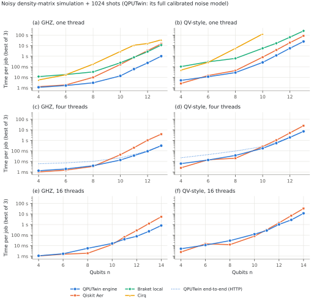
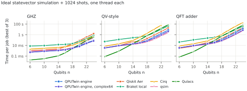
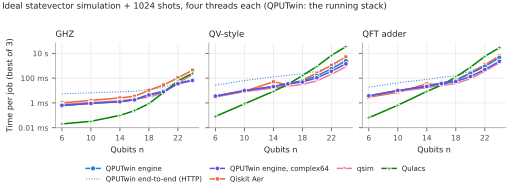
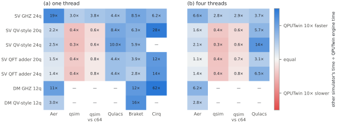
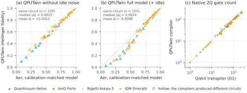
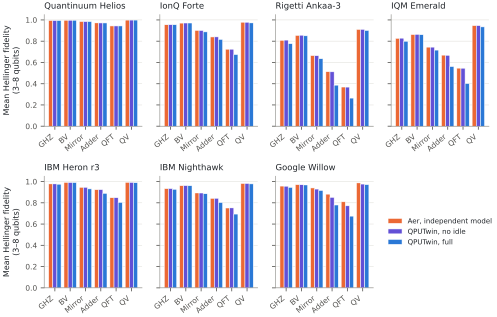

# Simulator comparison

A comparative benchmark of **QPUTwin** against **Qiskit Aer**, the **Amazon Braket local simulators**, **Cirq**, **qsim** and **Qulacs**:

1. **Correctness:** do they produce the same ideal output distributions?
2. **Speed:** ideal statevector and noisy density-matrix run time vs width, at equal thread budgets.
3. **Noise-model cross-validation:** does an *independently written* Qiskit Aer model, fed the identical calibration, reproduce QPUTwin's noisy results, and where does QPUTwin differ?
4. **Compilation:** how QPUTwin's router and native compiler compare with the Qiskit transpiler.

QPUTwin is measured on the **running Docker stack** (`http://localhost:8000`). The scripts only send HTTP requests to it; they never start, stop or reconfigure it. Single-thread timings of QPUTwin's engine use the identical code in-process.

## What changed after the first run

The first run (kept in `comparison/results/v1/`) showed QPUTwin's engine 5–78× slower than Aer and qsim, and a router that missed SWAP-free placements. Both were fixed in QPUTwin itself:

* **Fused, multithreaded execution.**
  * Native gates are fused into dense blocks of up to 5 qubits and applied with one matrix product per block, on a lazily permuted tensor.
  * A block that needs its qubits moved is applied *while* gathering cache-sized chunks, so the state is still read and written only once.
  * Noise channels, depolarisation and resets become superoperators and fuse with the gates around them in the density-matrix engine.
  * Trailing diagonal gates that cannot affect the measurement are skipped.
  * Work is split across the worker's CPU quota (`QPUTWIN_ENGINE_THREADS`).
* **A second round, after the first fused run (kept in `comparison/results/v2/`) still lost on shallow circuits:**
  * *Lazy activation.* Untouched qubits are exactly `|0⟩` and are not stored; a block reaching new qubits uses only the matrix columns where they are 0. A 24-qubit GHZ chain now reaches full size only in its last block.
  * *Wide diagonal blocks.* Phase-only gates fuse into blocks of up to 12 qubits, stored as their diagonal and applied as a phase table per cache chunk; consecutive diagonal blocks merge.
  * *No denormals.* Fused matrix entries below 10⁻¹⁵ (rounding noise such as cos π/2) are set to zero. Before, they decayed block after block into denormal numbers, which the CPU processes about 100× more slowly, and filled a GHZ state with 16 million near-zero amplitudes.
  * *Sampling without reordering.* Probabilities are taken in the stored axis order and written into the state's own memory; only the drawn outcomes are relabelled. A two-level inverse CDF avoids a full cumulative sum.
  * *Faster planning.* Gates are contracted directly into a block's rows instead of being embedded into a full matrix, which made small circuits about 35 % faster.
* The results match the per-gate reference kernels to < 1e-12 (30 regression tests, including every large-state branch on small states).
* **Exact layout before SABRE.** A VF2-style search places the circuit with zero SWAPs whenever its interaction graph embeds in the coupling graph.
* **SABRE trials scored by their real output.** Each trial routes the whole circuit, and the one with the fewest two-qubit gates is kept. Trial counts are now automatic (16 / 8 / 4 / 2 by circuit size).
* **API fix found on the way.** The orchestrator's request schema had silently pinned `trials` to 4 and rejected `bridge`, `optimize` and the new layout options. It now mirrors the worker's options.



## Setup

| Item | Value |
|---|---|
| Host | Intel Core i5-12450H (4 P + 4 E cores, 12 threads), 16 GB; load average 1.4–4.2 during the runs |
| QPUTwin | 0.1.0, running stack: one worker per QPU, 4-CPU quota, `QPUTWIN_ENGINE_THREADS` = 4 (its quota), complex128 (complex64 as a second series) |
| Compared | Qiskit 2.6.1 + Aer 0.18.2 · amazon-braket-sdk 1.127.6 + default simulator 1.42.0 · Cirq 1.7.0 · qsimcirq 0.22.1 · Qulacs 0.6.14 · numpy 2.5.4 |
| Circuits | the nine families of `benchmarks/circuits.py`, seed 1 |
| Date | 2026-10-28 |

### Fairness rules

* **Identical gate list.** Each program is parsed once by Qiskit and flattened to {U, CX} (`optimization_level=0`). Every in-process simulator gets exactly that list; the flattening is not timed. QPUTwin receives the source OpenQASM and compiles it to native gates itself.
* **Equal thread budgets.**
  * *One thread:* every simulator, including QPUTwin's engine run in-process.
  * *Four threads:* QPUTwin as the running stack, against Aer, qsim and Qulacs with 4 threads. Braket and Cirq are single-threaded and appear only in the one-thread comparison.
* **Timing.** Simulation plus sampling of 1024 shots. Each point is the best of 3 repetitions (one run above 2 s); a series stops after its first point over 60 s (120 s for noisy runs).
* **QPUTwin times are engine times** (simulation + sampling, from its own telemetry). The *end-to-end* HTTP round trip is plotted alongside as a dotted line.
* **Precision.** QPUTwin and all others use complex128, except qsim, which only runs complex64. A *QPUTwin complex64* series (`options.precision`) gives the like-for-like comparison.

## Results

### 1. Correctness: identical results



All nine families were compared at 4, 8, 12 and 16 qubits, up to 65 536 outcomes, with Qiskit Aer as the reference. The worst deviation was **1.6 × 10⁻¹⁴** for QPUTwin, ≤ 3 × 10⁻¹⁵ for Braket, Cirq and Qulacs, and 1 × 10⁻⁷ for qsim (single precision). All six simulators agree to rounding error.

### 2. Noisy density-matrix simulation: QPUTwin is the fastest



| Noisy circuit | QPUTwin | Qiskit Aer | Braket local | Cirq |
|---|---|---|---|---|
| GHZ, 12 qubits, 1 thread | **0.24 s** | 2.56 s | 2.97 s | 14.8 s |
| GHZ, 13 qubits, 1 thread | **1.00 s** | 11.5 s | 16.5 s | 37.1 s |
| QV-style, 12 qubits, 1 thread | **4.82 s** | 14.7 s | 77.3 s | > 120 s |
| QV-style, 13 qubits, 1 thread | **20.8 s** | 64.7 s | 372 s | > 120 s |
| GHZ, 13 qubits, 4 threads | **0.49 s** | 3.39 s | single-threaded | single-threaded |
| QV-style, 13 qubits, 4 threads | **6.71 s** | 18.8 s | single-threaded | single-threaded |

From 10 qubits, QPUTwin is **2.0–12× faster than Aer** (GHZ 4–12×, QV-style 2.0–3.1×) and 12–18× faster than Braket, at both thread budgets. It achieves this while running a **richer** model: its full calibrated channel per native gate, versus one depolarising channel per U/CX for the others. At 4–8 qubits, where everything takes milliseconds, Aer is level or up to 3× ahead.

### 3. Ideal statevector simulation





| Circuit | Threads | QPUTwin | QPUTwin c64 | Qiskit Aer | qsim (c64) | Qulacs | Braket | Cirq |
|---|---|---|---|---|---|---|---|---|
| GHZ, 24 qubits | 1 | 87 ms | **70 ms** | 1.62 s | 263 ms | 385 ms | 737 ms | 537 ms |
| QV-style, 24 qubits | 1 | 7.59 s | 4.31 s | 19.3 s | **2.62 s** | 75.8 s | 45.0 s | > 60 s |
| QFT adder, 24 qubits | 1 | 14.0 s | 7.26 s | 20.0 s | **5.57 s** | 61.8 s | 39.1 s | 192 s |
| GHZ, 24 qubits | 4 | 67 ms | **65 ms** | 437 ms | 188 ms | 250 ms | | |
| QV-style, 24 qubits | 4 | 2.44 s | 1.42 s | 5.17 s | **0.82 s** | 34.5 s | | |
| QFT adder, 24 qubits | 4 | 4.37 s | 2.26 s | 6.04 s | **1.70 s** | 28.5 s | | |



* **Shallow circuits (GHZ):** QPUTwin is now the **fastest of six from 20 qubits** (one thread) and 22 qubits (four threads): at 24 qubits 3.0× faster than qsim, 4.4× than Qulacs and 19× than Aer. Lazy activation means the chain touches a full-size state only once. Below 20 qubits Qulacs leads (its per-gate C++ calls cost microseconds), and QPUTwin is second, ahead of qsim and Aer, at 10–18 qubits on one thread.
* **Deep circuits (QV-style, QFT adder):** QPUTwin is the **second-fastest of six** from 16 qubits on one thread and 18 on four. It is 1.3–2.5× faster than Qiskit Aer (1.1–2.1× at four threads), 2.8–14× faster than Qulacs and Braket at 20–24 qubits, and up to 28× faster than Cirq. Only **qsim** is faster: by 1.8–3.0× against QPUTwin's default double precision, and by **1.2–1.75× at matched (single) precision**. qsim is hand-vectorised C++; QPUTwin's 5-qubit block products already run near the core's double-precision peak in BLAS, so closing the rest would need hand-written SIMD kernels. A numba prototype was not faster than BLAS on one thread and was not adopted.
* **Small widths (10–14 qubits):** on deep circuits Qulacs, qsim and Aer are ahead at 10 qubits, and qsim (plus Qulacs on the QFT adder) at 14; QPUTwin's engine takes 9–21 ms, mostly Python planning. A QPUTwin job costs tens of milliseconds end to end anyway, dominated by HTTP, validation and native compilation, not simulation.

### 4. The physics cross-validates

`noise_models.py` builds a Qiskit Aer model from the **same calibration the running containers report** (`GET /v1/backends/{id}`):
- **Inputs:** gate fidelities and durations, T1/T2 and readout errors.
- **Recipe:** the conventional per-gate model, thermal relaxation then depolarising noise solved to hit the published average gate fidelity, written with Qiskit's own channel algebra.
- **Self-check:** each gate matches its target fidelity to 10⁻⁹.

It is compared with QPUTwin on six families at 3–8 qubits on four devices: 132 cases, with 100 000 shots on each side.



| 105 cases where both compilers produced the same two-qubit circuit | Median \|Δ fidelity\| | Mean | Max \|Δ\| |
|---|---|---|---|
| QPUTwin **without** idle noise vs Aer-matched | **0.0015** | 0.0039 | 0.031 |
| QPUTwin full model vs Aer-matched | 0.0024 | −0.0098 (signed) | 0.108 |

| Device | Mean \|Δ\| (no idle vs Aer) | Mean idle-noise penalty | Max idle-noise penalty |
|---|---|---|---|
| Quantinuum Helios | 0.0011 | 0.000 | 0.000 |
| IonQ Forte | 0.0014 | 0.015 | 0.108 |
| Rigetti Ankaa-3 | 0.0069 | 0.045 | 0.190 |
| IQM Emerald | 0.0090 | 0.049 | 0.201 |



* **Two independent implementations agree.** Without idle decoherence, QPUTwin and the Aer model match to a median of 0.0015 in fidelity.
* **QPUTwin models what the standard recipe misses.** It applies relaxation while qubits wait in a real ASAP schedule with each device's parallelism limits. This costs up to **0.20** in fidelity on the superconducting twins and up to 0.11 on IonQ Forte, whose two-qubit gates run one at a time.

### 5. Compilation: QPUTwin's router beats the Qiskit transpiler (O1)

| QPUTwin's native two-qubit gate count, compared with Qiskit's (132 cases) | Cases |
|---|---|
| lower | **23** (QFT adder 202–206 against 229 at 8 qubits; QV-style 123 against 129; Cuccaro adder) |
| equal | 105 |
| higher | 4 (Helios Cuccaro adder: three cases, 2–6 more ZZ gates; Emerald mirror₈: 59 against 56) |
| **total over all cases** | **4 329 against 4 461 (−3.0 %)** |

The first run had 23 cases where QPUTwin needed more two-qubit gates. Those came from missed SWAP-free placements (e.g. GHZ₇ on Ankaa-3: 12 against 6) and from SABRE trials that were scored by an estimate. Both are fixed. The remaining Helios gap comes from Qiskit re-synthesising two-qubit blocks (KAK) around decomposed Toffolis, which QPUTwin's peephole pass does not do.

## Where QPUTwin stands

| Dimension | Result |
|---|---|
| Correctness | identical to all five simulators (≤ 2 × 10⁻¹⁴) |
| Noisy density-matrix speed | **fastest of the four** with a richer noise model (2.0–12× faster than Aer from 10 qubits) |
| Ideal statevector speed, shallow circuits | **fastest of six** from 20 qubits (3.0× faster than qsim at 24); Qulacs leads below |
| Ideal statevector speed, deep circuits | **2nd of six**, behind qsim only (1.2–1.75× at matched precision); faster than Aer, Qulacs, Braket, Cirq |
| Calibrated device noise | cross-validated against Aer; adds schedule-aware idle decoherence the others omit |
| Routing / native compilation | 3 % fewer two-qubit gates than the Qiskit transpiler (O1) overall |
| Device fidelity features | native gates, calibrated noise with provenance, gate timing, an HTTP service with telemetry: none of the others combine these |

QPUTwin is not faster than *every* simulator at *everything*: qsim's hand-vectorised C++ stays ahead on deep ideal circuits, and Qulacs on small ones. QPUTwin is the fastest on noisy density matrices and on shallow wide circuits, and for its actual purpose, calibrated emulation of specific QPUs, it is the fastest and most complete of the six.

## Limitations of this comparison

* QPUTwin's 4-thread numbers come from the service (engine time from telemetry); the others run in-process. Single-thread QPUTwin numbers use the identical code in-process.
* QPUTwin simulates its compiled native sequence; the others simulate the U/CX list. Each simulates what it would in practice.
* The noisy-speed test uses different noise models (§2): QPUTwin's is the more expensive one.
* Vendor cloud emulators (Quantinuum Nexus, IonQ cloud simulator, IQM Resonance) need accounts and run remotely, so they are not included. The calibration-matched Aer model is the reproducible stand-in.
* One host shared with the QPUTwin stack, with a moderate background load. Ratios transfer better than absolute times.

## Reproduce

The comparison lives in its own folder with a separate environment, so Qiskit, Braket, Cirq, qsim and Qulacs never enter QPUTwin's dependencies:

```bash
docker compose up -d --wait                                # the QPUTwin stack must be running
cd comparison && uv sync
uv run python run_comparison.py correctness sv_speed dm_speed    # one thread, ~30 min
uv run python run_comparison.py noise_xval                        # calibration-matched Aer cross-check
COMPARE_THREADS=4 uv run python run_comparison.py sv_speed dm_speed  # four threads, ~5 min
uv run python plot_comparison.py
```

Code, raw JSON results, CSVs and the PDF/SVG/PNG figures are in `comparison/` (see its README).
